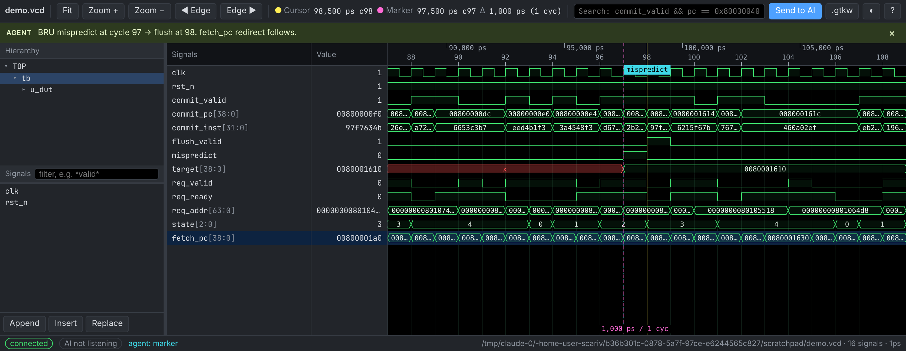

# waveview: AI と共有するブラウザ波形ビューワ

`tools/waveview.py` は GTKWave / Verdi と同じ感覚で操作できる波形ビューワです。
ただし画面はブラウザ、データはリモートのビルドサーバ上にあり、
**表示状態(信号リスト・カーソル・マーカ・ズーム・メモ)をサーバ側で 1 つ持つ**ので、
人とAIエージェントが同じ画面を同時に操作できます。

```
 リモートサーバ (ダンプがある場所)                 手元の PC
 ┌──────────────────────────────┐             ┌─────────────────┐
 │ tools/waveview.py serve w.fst│◀── HTTP ───▶│ ブラウザ          │
 │   共有ビュー状態               │  (ssh -L /  │ GTKWave 風の画面  │
 │   ▲            ▲             │   VS Code)  └─────────────────┘
 │   │ CLI        │ ファイル監視  │
 │ AI エージェント  シミュレータが   │
 │ (Claude Code)  w.fst を再生成   │
 └──────────────────────────────┘
```



## 起動

```sh
make WAVE=fst build-top
./obj_dir_top/tb_scariv_top ... +wave=w.fst +wave_from=1000 +wave_to=3000
tools/waveview.py serve w.fst            # URL(トークン付き)が表示される
```

- リモートなら `ssh -L 8765:localhost:8765 <host>` でポート転送して URL を開く。
  VS Code Remote は自動で転送する。X11 も GTKWave のインストールも不要
- Python 3 の標準ライブラリだけで動く。FST は Verilator 同梱の fstapi で読む
  (wave2img.py と同じ仕組み)
- 127.0.0.1 にだけ bind し、全リクエストにランダムトークンを要求する。
  共有サーバでも他ユーザーからは見えない
- シミュレーションをやり直してダンプが更新されると、表示状態を保ったまま自動で再読み込み
- 表示状態は `<dump>.waveview.json` に保存され、次回起動時に復元される
- `--gtkw save.gtkw` で GTKWave の保存ファイルを読み込める。ツールバーの `.gtkw` で書き出し

## 波形データはジャストインタイムに取得する

ダンプ全体はブラウザに送らない。表示中の行と時間範囲の分だけを、地図アプリの
タイルのように取りに行く。

- タイルはズームレベル L ごとに 1024 バケット (1 バケット = 2^L 時間単位) を持つ。
  ブラウザは 1 バケットがおよそ 1 ピクセルになるレベルを選び、見えている行の
  見えているタイル (と左右 1 枚ずつ) だけを要求する
- **ズームアウト時は要約**: 1 バケットに複数の変化があれば「密な区間」にまとめ、
  変化数と (1 ビット信号なら) 1 の割合だけを送る。隣り合う同じ濃さの区間は 1 つに
  まとめる。画面では濃淡のブロックとして描かれ、どこが忙しいか・どこで
  パルスが出ているかの雰囲気がわかる (1 サイクルのパルスも消えずに線で残る)
- **ズームインすると、その場所の詳細を取得**。届くまでの間は手元にある粗いタイルを
  引き伸ばして表示し、届いたら置き換える
- 密な区間を含まないタイルは「正確」。それ以上ズームインしても新しい転送は起きない
- 取得したタイルはブラウザがキャッシュするので、戻る・パンするだけなら再転送しない
- 値は 16 進、時刻は差分で送り、gzip 圧縮する。クロックが等間隔ならサイクル番号は
  ブラウザで計算する
- ステータスバーに受信量 (`↓ 29.1 KB · 2 req · 30 tiles cached`) が出る

目安 (20 万サイクル, 16 信号, VCD 29 MB, 1 Mbps / 100 ms に絞った回線で計測):
全体表示まで 29 KB / 約 1.2 秒、そこから 4096 倍までズームインしても累計 675 KB。
ズームアウトして戻る操作では転送なし。

## 画面と操作 (GTKWave / Verdi nWave 準拠)

左に階層ツリーと信号リスト (GTKWave の SST)、中央に信号名と値 (カーソル位置)、右に波形。

| 操作 | 動作 |
|---|---|
| クリック | カーソル (行も選択) |
| Shift+クリック / 中ボタン | マーカ。カーソルとの差を時間とサイクル数で表示 |
| ドラッグ | 範囲ズーム |
| Ctrl+ホイール / Shift+ホイール / ホイール | ズーム / 時間方向スクロール / 行スクロール |
| `f` `z` `Z` | 全体表示 / ズームアウト / ズームイン |
| `←` `→` | 選択信号の前 / 次の変化点へ |
| `/` または Ctrl+F, `n` `N` | 条件式サーチ (例 `commit_valid && pc == 0x80000040`), 次 / 前 |
| `c` `m` | カーソルを中央に / カーソル位置にマーカ |
| `↑` `↓`, Alt+`↑` `↓`, Delete | 行選択 / 行の移動 / 削除 |
| `h` `d` `s` `b` `o` | 基数 hex / dec / signed / bin / oct (右クリックメニューにもある) |
| `a` | Send to AI |
| `?` | ショートカット一覧 |

信号はツリーでスコープを選び、リストからダブルクリックかドラッグで追加。
フィルタ欄で Enter を押すとヒットした信号をまとめて追加。時間軸にはクロック
立ち上がりごとのグリッドとサイクル番号が出る。

## ソース表示: Active Annotation とドライバの追跡 (Verdi nTrace 風)

```sh
tools/waveview.py serve w.fst --rtl core/filelist.f --rtl core/tb/top
```

`--rtl` に filelist (.f)・ファイル・ディレクトリを渡すと RTL を索引する
(省略時はカレントディレクトリ、vendor/ と obj_dir は除く)。索引は
`tools/rtlindex.py` による軽量な解析で、エラボレータは使わない。
ダンプの階層名 (`TOP.tb_scariv_top.u_dut.u_rob.r_rob_head`) をモジュール・
インスタンス・generate ブロックをたどってソースに対応づける。ソースを編集すると
自動で索引し直す。


| 操作 | 動作 |
|---|---|
| 波形の信号名・波形をダブルクリック | その信号のドライバへジャンプ (Shift でロード) |
| ソース上の信号をダブルクリック | ドライバを追跡 (Shift+ダブルクリックでロード) |
| ソース上のインスタンス名をダブルクリック | そのインスタンスの中へ |
| Ctrl+クリック / 中クリック | 信号を波形に追加 |
| 右クリック | ドライバ / ロード追跡、波形に追加、AI に質問、階層名コピー |
| パンくずリスト | 上位階層へ |
| ◀ ▶ / Alt+← → | 履歴 |
| `S` | ソースペインの表示切り替え |

- **Active Annotation**: ソース中の各信号の横に、カーソル時刻の値を表示する。
  カーソルを動かすと追従し、そのクロックで値が変わった信号は黄色、x/z は赤
- **ドライバ追跡は階層をまたぐ**: インスタンスの出力ポートにつながる信号なら
  サブモジュールの中へ、入力ポートなら親のポート接続へ自動でたどり、実際の
  `assign` / `always` に着くまで進む。通った経路は左のリストに `via u_rob.o_rob_head`
  のように出る。ドライバが複数あればリストから選ぶ
- 対応している書き方: ANSI / 非 ANSI ポート、ユーザ定義型の宣言、assign、
  always 系の `=` `<=`、連接の左辺、名前付き・`.port`・`.*`・位置指定の接続、
  パラメータ、インスタンス配列、generate。`ifdef は両側とも索引する
- 解析は構文の近似なので、マクロで組み立てた信号名や interface の modport 経由の
  接続は追えないことがある

AI からは同じことをテキストで行える:

```sh
tools/waveview.py src u_rob.r_rob_head            # 宣言とドライバ、各行の信号のカーソル時刻の値
tools/waveview.py src u_rob.r_rob_head --loads    # 読んでいる側
tools/waveview.py src u_rob.r_rob_head --open     # ユーザーのソースペインにも表示する
tools/rtlindex.py core/filelist.f core/tb/top --trace TOP.tb_scariv_top.u_dut.w_rob_head
```

## AI エージェントとの連携

エージェント (や任意のシェル) から CLI で同じ画面を操作できる。実行中のサーバは
`~/.cache/scariv/waveview/` から自動で見つけるので、ポートやトークンの指定は要らない。

```sh
tools/waveview.py look            # 今ユーザーが見ている画面をテキストで (値・カーソル・マーカ)
tools/waveview.py add '*u_rob.commit_*'
tools/waveview.py goto --cycle 1234 --span 40
tools/waveview.py annotate --cycle 1230 "mispredict"
tools/waveview.py note "flush は 1230 の BRU mispredict が原因"
tools/waveview.py find 'rose(flush_valid)'
tools/waveview.py inbox --wait 600   # ユーザーの「Send to AI」を待つ
```

- エージェントの操作は即座にブラウザに反映され、ステータスバーに `agent: goto` のように出る
- エージェントのメモは画面上部のバナーに、ラベルは時間軸の旗として表示される
- 「Send to AI」ボタン (または右クリック → Ask AI) で、メッセージと**その時の画面状態**
  がエージェントに届く。エージェントが `inbox --wait` で待っている間はステータスバーに
  「AI listening」と表示される
- 深掘りのテキスト問い合わせは `tools/wavequery.py` (table / find / changes) を使う。
  Claude Code 向けの手順は `.claude/skills/wave-debug/SKILL.md`

HTTP API (`/api/cmd`, `/api/snapshot`, `/api/wave`, `/api/events` など) も
そのまま使えるので、他のエージェントやスクリプトからも同じ操作ができる。

## テスト

```sh
tools/waveview.py selftest
tools/wavequery.py --selftest
tools/rtlindex.py --selftest
```
