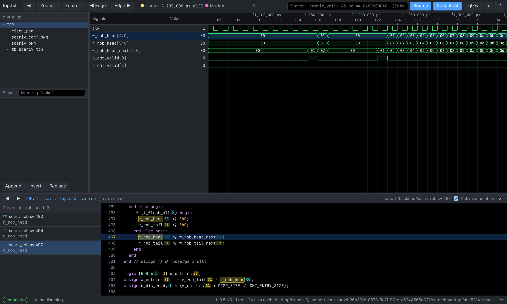

# waveview: AI と共有するブラウザ波形ビューワ

`waveview.py` は GTKWave / Verdi と同じ感覚で操作できる波形ビューワです。
ただし画面はブラウザ、データはリモートのビルドサーバ上にあり、
**表示状態(信号リスト・カーソル・マーカ・ズーム・メモ)をサーバ側で 1 つ持つ**ので、
人とAIエージェントが同じ画面を同時に操作できます。

```
 リモートサーバ (ダンプがある場所)                 手元の PC
 ┌──────────────────────────────┐             ┌─────────────────┐
 │ waveview.py serve w.fst│◀── HTTP ───▶│ ブラウザ          │
 │   共有ビュー状態               │  (ssh -L /  │ GTKWave 風の画面  │
 │   ▲            ▲             │   VS Code)  └─────────────────┘
 │   │ CLI        │ ファイル監視  │
 │ AI エージェント  シミュレータが   │
 │ (Claude Code)  w.fst を再生成   │
 └──────────────────────────────┘
```


## 起動

```sh
# シミュレーションで FST を出す (Verilator なら --trace-fst、他のシミュレータは各自の方法)
waveview.py serve w.fst            # URL(トークン付き)が表示される
```

- リモートなら `ssh -L 8765:localhost:8765 <host>` でポート転送して URL を開く。
  VS Code Remote は自動で転送する。X11 も GTKWave のインストールも不要
- Python 3 の標準ライブラリだけで動く。FST は Verilator 同梱の fstapi で読む
  (wave2img.py と同じ仕組み)
- 127.0.0.1 にだけ bind し、全リクエストにランダムトークンを要求する。
  共有サーバでも他ユーザーからは見えない
- シミュレーションをやり直してダンプが更新されると、表示状態を保ったまま自動で再読み込み
- 表示状態は `<dump>.waveview.json` に保存され、次回起動時に復元される
- `--gtkw save.gtkw` で GTKWave の保存ファイルを読み込める。ツールバーの `.gtkw` で書き出し

## 巨大なダンプ: FST はその場で、必要な分だけ読む

FST は VCD に変換もしないし、メモリに読み込みもしない。`fstsrv.c`
(Verilator 同梱の FST ライブラリで自動ビルド) がダンプを開いたまま常駐し、
問い合わせごとに **指定した信号・指定した時間範囲だけ** を読む。

- 開くときに読むのは階層だけ。ファイルの大きさに関係なく一瞬で開く
- FST はブロックごと・信号ごとに別々に圧縮されているので、要求された信号の、
  要求された時間に重なるブロックだけを展開する
- ズームアウト時のタイル (バケットごとの変化数・1 の割合) は C 側で集計して
  結果だけを返す。全変化が Python を通ることはない
- クロックは先頭と末尾の立ち上がりが等間隔なら周期で表す (2000 万サイクルでも
  エッジ一覧を持たない)
- 検索 (find / table --where / 画面の Search) は、式の信号が変化したサイクル
  (と prev/rose の遅れ分) でだけ評価する。結果はサイクルごとの評価と完全に一致する
- `WAVE_EAGER=1` で従来の「変換して全部読む」動作に戻せる

3.6 GB の FST (2000 万サイクル, 322 信号, 約 14 億変化) での実測:

| 操作 | 時間 |
|---|---|
| 開く (階層) | 0.003 秒 |
| クロック判定 | 0.006 秒 |
| 全体表示のタイル (22 信号 × 全 2000 万サイクル) | 4.6 秒 (以降キャッシュ) |
| ズームイン時のタイル | 数 ms |
| 全 322 信号のある時刻の値 | 0.18 秒 |
| `find 'rose(rst_n)' --first` | 0.4 秒 |
| 変化の多い 64 bit バスで全区間検索 (一致なし) | 28 秒 |
| メモリ | Python 74 MB / fstsrv 8 MB |

VCD は形式上インデックスがないので先頭から全部読むしかない。大きいものは
一度 FST にしてから使う (GTKWave の `vcd2fst`、あるいはシミュレータで
直接 FST を出す: Verilator なら `--trace-fst`)。FSDB は Verdi のある環境なら
同じプロトコルを話す `fsdbsrv` (fsdbsrv.cc, Verdi の FsdbReader ライブラリで
ビルド) でその場で読むので FST と同じ動きになる。Verdi が無ければ fsdb2vcd
経由で、大きいものは VCD と同じ問題がある。

## 波形データはジャストインタイムに取得する

ダンプ全体はブラウザに送らない。表示中の行と時間範囲の分だけを、地図アプリの
タイルのように取りに行く。

- タイルはズームレベル L ごとに 1024 バケット (1 バケット = 2^L 時間単位) を持つ。
  ブラウザは 1 バケットがおよそ 1 ピクセルになるレベルを選び、見えている行の
  見えているタイル (と左右 1 枚ずつ) だけを要求する
- **ズームアウト時は要約**: 1 バケットに複数の変化があれば「密な区間」にまとめ、
  変化数と (1 ビット信号なら) 1 の割合だけを送る。隣り合う同じ濃さの区間は 1 つに
  まとめる。画面では濃淡のブロックとして描かれ、どこが忙しいか・どこで
  パルスが出ているかの雰囲気がわかる (1 サイクルのパルスも消えずに線で残る)
- **ズームインすると、その場所の詳細を取得**。届くまでの間は手元にある粗いタイルを
  引き伸ばして表示し、届いたら置き換える
- 密な区間を含まないタイルは「正確」。それ以上ズームインしても新しい転送は起きない
- 取得したタイルはブラウザがキャッシュするので、戻る・パンするだけなら再転送しない
- 値は 16 進、時刻は差分で送り、gzip 圧縮する。クロックが等間隔ならサイクル番号は
  ブラウザで計算する
- ステータスバーに受信量 (`↓ 29.1 KB · 2 req · 30 tiles cached`) が出る

目安 (20 万サイクル, 16 信号, VCD 29 MB, 1 Mbps / 100 ms に絞った回線で計測):
全体表示まで 29 KB / 約 1.2 秒、そこから 4096 倍までズームインしても累計 675 KB。
ズームアウトして戻る操作では転送なし。

## Verdi との連携: FSDB と nWave の .rc

```sh
waveview.py serve sim.fsdb --rc signal.rc --rtl core/filelist.f
```

- **FSDB を変換せずにそのまま開ける。** FSDB は Synopsys の非公開フォーマットで、
  読めるのは Verdi 付属のライブラリだけなので、Verdi がインストールされた
  サーバで使う。`fsdbsrv.cc` を Verdi の FsdbReader ライブラリ
  (`$VERDI_HOME/share/FsdbReader` の `ffrAPI.h`, `libnffr`, `libnsys`) で
  初回に自動ビルドし (`~/.cache/waveview/build/fsdbsrv`)、FST と同じく
  階層だけ読んで開き、画面に必要な信号・時間範囲だけを読む。Verdi は
  `$VERDI_HOME`、無ければ PATH の `verdi` / `fsdb2vcd` から探す。
  別の場所でビルドした fsdbsrv は `WAVEVIEW_FSDBSRV` で指定できる
- **手元の PC から**: `serve build01:/work/sim/w.fsdb` で、サーバの Verdi で
  fsdbsrv をビルドしてサーバ側で動かす (FST の `fstsrv` と同じ仕組み、
  「Windows から」の節を参照)。サーバ側のビルドは `WAVEVIEW_REMOTE_FSDBSRV`
  で差し替えられる
- サーバのログイン環境に `VERDI_HOME` が無い (module load などで都度設定する)
  場合は、手元で `WAVEVIEW_REMOTE_ENV="VERDI_HOME=/tools/synopsys/verdi/Y-2026.03-SP2"`
  を設定する。サーバで実行する全コマンドにその環境変数が付く
  (ssh はログインシェルを通さないので、サーバの `~/.bashrc` の export は効かない
  ことがある)
- FsdbReader ライブラリが無い (fsdb2vcd だけある) 環境では、従来どおり Verdi の
  `fsdb2vcd` で VCD に変換して読む (`$FSDB2VCD` → `PATH` → `$VERDI_HOME/bin`
  の順に探す。変換と解析は最初の 1 回だけで、以降はキャッシュを使う)。
  巨大な FSDB は `FSDB2VCD_CMD` で fsdb2vcd のコマンドラインを変え、fsdb2vcd 側の
  スコープ・時間範囲の指定で絞れる (既定 `{bin} {in} -o {out}`)
- 読むのは 0/1/x/z の信号 (1 バイト/ビットで格納されたもの)。real・文字列・
  トランザクションは出てこない
- **信号が数千万本ある巨大なダンプ** (エミュレータの FSDB など) は、信号名の
  一覧を読むだけで数分かかる。2 つの手がある
  - `--scope tb.u_dut.u_core` (`/tb/u_dut/u_core` でもよい、複数指定可):
    そのスコープより下の信号だけを読み込む。wavequery と `serve` の両方、
    FST / FSDB / ssh 越しのどれでも使える。ビューアで巨大なダンプを開くときは
    これを使う
  - **名前の索引** (手元の FSDB を wavequery で読むとき、自動): 変数の idcode が
    100 万を超える FSDB は、最初の問い合わせで信号名を
    `~/.cache/waveview/index` に書き出し (1 信号あたり約 25 バイト、8,400 万信号で
    2GB)、2 回目以降はダンプのスコープだけを読んで名前は索引から探す。
    8,400 万信号の FSDB で、1 回 4 分 → 初回 40 秒・以降 3〜10 秒。
    ダンプが書き換わると (サイズ・更新時刻が変わると) 作り直す。古い索引は
    自動では消えないので、要らなくなったら index ディレクトリを消す。
    `WAVE_INDEX_DIR` で置き場所、`WAVE_INDEX=0` で無効化、`WAVE_INDEX_MIN` で
    使い始める大きさを変えられる。`list` で全信号に当たるパターン
    (`*clk*` など) は索引を端から読むので遅い。階層を足して絞ると速い
- **nWave の保存ファイル (.rc) を読める** (`--rc`)。`addSignal` の信号と基数
  (`-HEX` `-DEC` `-2COMP` `-BIN` `-OCT`)、`cursor` `marker` `zoom` を取り込む。
  階層は末尾一致で探すので、VCS の FSDB (`/tb/u_dut/...`) 用の .rc を
  Verilator の FST (`TOP.tb.u_dut...`) に使うこともできる
- ツールバーの `.rc` (または `waveview.py rc`) で今の表示を nWave の .rc として
  書き出せる。Verdi で `File > Restore Signal` すれば同じ信号・カーソル・ズームで開く
- wavequery / wave2img も同じ仕組みで .fsdb を読める

## デバッグビューを rc ファイルで渡す (.wvrc)

waveview 独自の rc ファイル (.wvrc) に「見るべき信号」「見るべきタイミング (名前付き
カーソル)」「矢印とコメント」を書いておくと、そのファイルを渡すだけで同じデバッグ画面が
開く。バグ報告に添付したり、AI エージェントが調べた結果をファイルで残したりできる。

```sh
waveview.py serve --rc bug123.wvrc        # ダンプは rc の dump 行から (dump を引数で渡してもよい)
waveview.py load bug123.wvrc              # 起動中のビューワに読み込む (--merge で追加)
waveview.py load -e 'comment flush_valid@1234c "ここ"'   # 1 行だけ追加
waveview.py save bug123.wvrc              # 今の画面を .wvrc に保存
waveview.py unmark arrow 0                # 矢印 #0 を消す (番号は look に出る)
```

書式 (1 行 1 コマンド、シェルと同じクォート、`#` 以降はコメント)。完全な例は
[`docs/example.wvrc`](example.wvrc)、仕様は `waverc.py` 冒頭。

```sh
dump    ../sim/w.fst                      # rc ファイルからの相対パス。host:/path も可
clock   tb.clk
note    "mispredict 後の flush が 2 サイクル遅い"      # 画面上部のバナー

signal  u_bru.o_mispredict_valid radix=bin   # フルネーム / 末尾一致 / グロブ
signal  '*u_rob.commit_*'

cursor  A 1230c "mispredict" color=red    # 名前付きカーソル: 名前 時刻 [ラベル] [color=]
cursor  B A+4c  "flush"      color=green  # 他のカーソルからの相対
cursor  B                                 # メインカーソル (引数 1 つ)
marker  A
zoom    A-6c B+6c                         # 省略時は書いた時刻全部が入るように自動ズーム

arrow   u_bru.o_mispredict_valid@A -> u_rob.flush_valid@B "4 cycles"
comment u_rob.flush_valid@A+2c "ここで立つはず\n(\n で改行)" color=orange
comment @A+1c "時間軸上のコメント"
```

- 時刻: `1234c` (サイクル = クロックの立ち上がり)、`5000` (ダンプの時間単位)、
  `12ns` `3.5us` (単位付き)、`A` `cursor` `marker` (カーソル名)、`A+3c` `B-10ns` (相対)
- 点 (`arrow` / `comment`): `信号@時刻`、時間軸なら `@時刻`。矢印・コメントで参照した
  信号が一覧に無ければ自動で追加する
- 色: `red orange yellow green cyan blue purple pink white gray` または `#rrggbb`
- 読めない行 (存在しない信号など) は警告を出してスキップし、残りは適用する
- 読み込みは画面を置き換える (名前付きカーソル・矢印・コメント・ラベル・メモ。信号一覧は
  ファイルに signal 行があれば置き換え)。`--merge` / `-e` は追加
- `--rc` は Verdi nWave の .rc も受け付ける (中身で自動判別)

ブラウザでは:

- 波形を**右クリック** → 「Named cursor here…」「Comment on … here…」「Arrow from … here」
  (続けて矢印の先をクリック、Esc で取り消し)。クロックエッジ近くなら時刻はエッジに吸着する
- 既存のカーソル・矢印・コメントを右クリック → 編集 / 削除
- `[` / `]` で前 / 次の名前付きカーソルへジャンプ
- ツールバーの `.wvrc` で保存、`Load rc` で .wvrc (または nWave .rc) を読み込み

## Windows (手元の PC) からリモートの FST を見る

ビューワを手元の Windows で動かし、FST はビルドサーバに置いたまま読む。
サーバで常駐させるものも、ポート転送も要らない。

```bat
rem 初回だけ: Python 3 (python.org か winget install Python.Python.3.12) と、
rem サーバへ鍵で入れる ssh (Windows 10 以降は OpenSSH クライアントが標準で入っている)
tools\waveview.cmd serve build01:/work/sim/w.fst --rtl build01:/work/proj/rtl/filelist.f --rtl-root /work/proj --open
```

- `ssh://user@host:port/abs/path` か `user@host:/abs/path` で指定する
  (`C:/...` のような 1 文字 + `:` はドライブとして扱う)。`~/.ssh/config` の
  別名・踏み台 (ProxyJump)・ssh-agent はそのまま使える
- 仕組み: `fstsrv` は標準入出力で話すので、`ssh -T -C host fstsrv w.fst` で
  サーバ側に置いたまま動く。画面が必要とする信号・時間範囲・要約だけが
  ssh を通り、ssh の圧縮もかかる
- サーバ側の準備は不要。初回接続時に `fstsrv.c` を ssh で送り、サーバの
  Verilator の FST ライブラリでビルドして `~/.cache/waveview/wavesrv/` に置く。
  場所は手元で覚えるので、2 回目からは接続 1 本で始まる (消されていたら作り直す)
- ソース表示: `--rtl host:/path` はサーバ上で `rtlindex.py` を (ssh で送って)
  python3 で実行して索引を作り、ソースペインで開いたファイルだけを取りに行く。
  `--rtl-root` はファイル名を表示する基準のディレクトリ
- シミュレーションがダンプを書き直すと、ssh 越しに検知して読み直す
- wavequery も同じ指定で使える: `py tools\wavequery.py find build01:/work/sim/w.fst "rose(flush)"`
- ssh コマンドは `WAVEVIEW_SSH` で差し替えられる (例 `plink -batch`)。
  サーバに C コンパイラか Verilator がなければ、別の場所でビルドした fstsrv を
  `WAVEVIEW_REMOTE_FSTSRV` で指定する
- リモートは FST と FSDB (サーバに Verdi があるとき: `fsdbsrv` を同じ手順で
  サーバ側にビルドする)。VCD はサーバで waveview を動かす従来の方法 (ssh -L) で見る

## macOS (手元の Mac) から使う

Mac でも同じ。`python3` は Xcode コマンドラインツールに入っているので、
リポジトリをそのまま使える:

```sh
python3 waveview.py serve build01:/work/sim/w.fst --rtl build01:/work/proj/rtl/filelist.f --rtl-root /work/proj --window
```

- `--window` は Chrome / Edge / Chromium / Brave をアプリモードで開き、
  ウィンドウを閉じるとサーバも終わる。どれも無ければ既定のブラウザで開く
- 手元の FST を直接開くには `fstsrv` のビルドが要る。`brew install verilator`
  で入る Verilator 5.041 以降は FST の読み取りライブラリを同梱しなくなった
  ので、その場合は下のスタンドアロン版 (ヘルパー同梱) を使う。
  リモートの FST はサーバ側でビルドするので手元には何も要らない

### スタンドアロン版 `waveview.app`

Python も Verilator も C コンパイラも要らない。ダブルクリックするとウィンドウが
開くので、**Open…** で This Mac か `~/.ssh/config` のホストを選び、Connect
してダンプを開く。`.fst` / `.vcd` / `.fsdb` をアイコンに落としても (または
「このアプリケーションで開く」でも) 開ける。Dock にアイコンは出ず、ウィンドウを
閉じるとプログラムも終わる。手元の FSDB は Verdi の `fsdb2vcd` が別途要る
(Verdi のあるサーバ上の FSDB はサーバ側で読む)。

- 署名 (公証) はしていないので、初回は右クリック → 開く、または
  `xattr -dr com.apple.quarantine waveview.app`
- ウィンドウに端末はないので、ssh は鍵 (パスフレーズ付きなら ssh-agent) で
  入れるようにし、ホスト鍵は一度端末から接続して受け入れておく
- `dist/waveview` は同じものをコマンドとして使う形:
  `./waveview serve w.fst --open`、`./waveview add '*commit*'` など
- 作り方: Mac で `./build_macos.sh` (Xcode コマンドラインツールと python3 が
  あればよい)。結果は `dist/waveview.app` と `dist/waveview`。ビルドした
  Mac の CPU (Apple silicon / Intel) 向けになる

## 画面と操作 (GTKWave / Verdi nWave 準拠)

左に階層ツリーと信号リスト (GTKWave の SST)、中央に信号名と値 (カーソル位置)、右に波形。

| 操作 | 動作 |
|---|---|
| クリック | カーソル (行も選択) |
| Shift+クリック / 中ボタン | マーカ。カーソルとの差を時間とサイクル数で表示 |
| ドラッグ | 範囲ズーム |
| Ctrl+ホイール / Shift+ホイール / ホイール | ズーム / 時間方向スクロール / 行スクロール |
| `f` `z` `Z` | 全体表示 / ズームアウト / ズームイン |
| `←` `→` | 選択信号の前 / 次の変化点へ |
| `/` または Ctrl+F, `n` `N` | 条件式サーチ (例 `commit_valid && pc == 0x80000040`), 次 / 前 |
| `c` `m` | カーソルを中央に / カーソル位置にマーカ |
| `↑` `↓`, Alt+`↑` `↓`, Delete | 行選択 / 行の移動 / 削除 |
| `h` `d` `s` `b` `o` | 基数 hex / dec / signed / bin / oct (右クリックメニューにもある) |
| `a` | Send to AI |
| `?` | ショートカット一覧 |

信号はツリーでスコープを選び、リストからダブルクリックかドラッグで追加。
リストの右側にはダンプが持つ宣言の種別 (`in` / `out` / `inout` と `wire` / `reg` /
`logic` / `integer` など) が出る (FST・FSDB は方向も、VCD は型だけ)。
フィルタ欄で Enter を押すとヒットした信号をまとめて追加。時間軸にはクロック
立ち上がりごとのグリッドとサイクル番号が出る。ツリーのノードを右クリックすると、
そのモジュールの定義 (ファイルと行) や、親モジュールでインスタンス化している
場所をソースペインで開ける (ソース索引があるとき)。

**Open… ダイアログ**: ツールバーの Open… で This Mac / This PC か `~/.ssh/config` の
ホストを選び、フォルダを辿ってダンプを開く。RTL 欄は手で書く他に、**Browse…** で
同じ一覧からファイルリスト (.f / .vc / .flist) や design JSON / Verilator XML を
選ぶか、**Use this folder** でフォルダ自体を指定できる。

## ブロック図: スコープの中身と接続

ツールバーの **Diagram** (`D`) で、選択中のスコープのブロック図を開く。

- 箱は子インスタンス。モジュール名、配下の信号数・インスタンス数・ソース行数を
  表示し、大きさも配下の信号数で変える。ダンプに無いインスタンス (索引にだけある)
  は点線
- 各箱の左右にインターフェースの束 (バンドル) を出す。信号名の接尾語から
  AXI4 / AXI4-Lite / AXI4-Stream、APB、AHB、CHI、TileLink、Wishbone、Avalon-MM、
  汎用の valid/ready・req/ack、clock / reset を判定し、方向が分かれば
  master / slave (source / sink、requester / completer) も付ける。判定は名前の
  規則だけで決定的に行う (ifaces.py)。合わなかった信号は先頭の単語でまとめる
- 箱同士の線はソース索引のネット接続から引く (束ごとに 1 本、太さはビット幅、
  色はプロトコル)。索引が無ければ箱と束だけが出る。clock / reset は細い点線
- 配置は要求の向き (master → slave) で左から右へ。左端がスコープの入力ポート、
  右端が出力ポート
- 箱クリックでそのスコープを選択、ダブルクリックで中へ、右クリックでモジュール
  定義 / インスタンス化箇所へ (ソースペイン)。線をクリックするとその束の信号を
  波形に追加。`#diagram=<scope>` を URL に付けると起動時に開く
- AI からは `waveview.py diagram <scope>` (または `--json`) で同じ内容を文字で読める。
  名前から判定できなかった束 (`?`) に AI が名前を付ける、というのが次の段階

## ソース表示: Active Annotation とドライバの追跡 (Verdi nTrace 風)

```sh
waveview.py serve w.fst --rtl core/filelist.f --rtl core/tb/top
```

`--rtl` に filelist (.f)・ファイル・ディレクトリを渡すと RTL を索引する
(省略時はカレントディレクトリ、vendor/ と obj_dir は除く)。索引は
`rtlindex.py` による軽量な解析で、エラボレータは使わない。
ダンプの階層名 (`TOP.tb_scariv_top.u_dut.u_rob.r_rob_head`) をモジュール・
インスタンス・generate ブロックをたどってソースに対応づける。ソースを編集すると
自動で索引し直す。



| 操作 | 動作 |
|---|---|
| 波形の信号名・波形をダブルクリック | その信号のドライバへジャンプ (Shift でロード) |
| ソース上の信号をダブルクリック | ドライバを追跡 (Shift+ダブルクリックでロード) |
| ソース上のインスタンス名をダブルクリック | そのインスタンスの中へ |
| Ctrl+クリック / 中クリック | 信号を波形に追加 |
| 右クリック | ドライバ / ロード追跡、波形に追加、AI に質問、階層名コピー |
| パンくずリスト | 上位階層へ |
| ◀ ▶ / Alt+← → | 履歴 |
| `S` | ソースペインの表示切り替え |

- **Active Annotation**: ソース中の各信号の横に、カーソル時刻の値を表示する。
  カーソルを動かすと追従し、そのクロックで値が変わった信号は黄色、x/z は赤
- **ドライバ追跡は階層をまたぐ**: インスタンスの出力ポートにつながる信号なら
  サブモジュールの中へ、入力ポートなら親のポート接続へ自動でたどり、実際の
  `assign` / `always` に着くまで進む。通った経路は左のリストに `via u_rob.o_rob_head`
  のように出る。ドライバが複数あればリストから選ぶ
- 対応している書き方: ANSI / 非 ANSI ポート、ユーザ定義型の宣言、assign、
  always 系の `=` `<=`、連接の左辺、名前付き・`.port`・`.*`・位置指定の接続、
  パラメータ、インスタンス配列、generate。`ifdef は両側とも索引する
- 解析は構文の近似なので、マクロで組み立てた信号名や interface の modport 経由の
  接続は追えないことがある

### ソース解析のバックエンド: ヒューリスティック / エラボレーション済み

`--rtl` に渡すものでバックエンドが変わる。

| `--rtl` に渡すもの | 中身 | 精度 |
|---|---|---|
| filelist / ファイル / ディレクトリ | `rtlindex.py` による構文の近似解析 | 普通の RTL なら十分。マクロ・interface は弱い |
| `design.xml` (Verilator `--xml-only`) | Verilator がエラボレーションした結果 | 正確。generate 展開・パラメータ違いのモジュール・ポート接続の列位置まで |
| `design.json` (waveview design 形式) | 任意のツールが書き出したエラボレーション結果 | 書き出し元しだい |

```sh
# ビルドと同じフラグ・ファイルで --xml-only を付けて Verilator を流す (数秒)
verilator --xml-only --xml-output design.xml --top-module <tb> <ビルドと同じ -f / +define / ソース>
waveview.py serve w.fst --rtl design.xml
```

### KDB / simv.daidir について

Verdi の KDB (vericom の `work.lib++`) や VCS の `simv.daidir` (`-kdb` 付き) も
エラボレーション済みの設計データベースで、上の表の 2 行目と同じ精度になる。
どちらも Synopsys の非公開バイナリ形式で、読めるのは Verdi の NPI (Novas Programming
Interface) だけなので、waveview は `npi_export.py` を Verdi 同梱の Python
(`$VERDI_HOME/platform/linux64/python-3.11`) と NPI ライブラリで動かして
**design JSON に書き出し、それを読む**。`--rtl work.lib++` や `--rtl simv.daidir`
と指定するだけで初回に自動で書き出し (`~/.cache/waveview/design/` にキャッシュ、
KDB が更新されたら作り直す)、Open ダイアログの Browse… でも `▣ work.lib++` のように
一覧に出て選べる。

```sh
vericom -sv -f filelist.f -top tb          # または vcs -kdb ...  → simv.daidir
waveview.py serve w.fsdb --rtl work.lib++
waveview.py serve build01:/work/sim/w.fsdb --rtl build01:/work/sim/work.lib++   # サーバの Verdi で書き出す
npi_export.py work.lib++ -o design.json    # 手で書き出すとき
```

- 必要なもの: Verdi (`VERDI_HOME`、または PATH の `verdi`) と Verdi のライセンス
  (`SNPSLMD_LICENSE_FILE`)。サーバのログイン環境に無ければ手元の
  `WAVEVIEW_REMOTE_ENV="VERDI_HOME=... SNPSLMD_LICENSE_FILE=..."` で渡す
- KDB から取るのは、ソースの文字列解析では確実に分からないもの:
  エラボレーション後のインスタンスツリー (generate 展開済み、パラメータの組ごとに
  モジュールを分ける)、各モジュールと宣言・代入文・インスタンス化の実際のファイルと行
  (`` `include `` 先も含む)、ポートの向きと接続。読み出し位置 (loads) だけは
  モジュール範囲のソース文字列から拾う
- 形式は [waveview_design_format.md](waveview_design_format.md)。別のデータベースからの
  exporter も同じ形式を書けばよい
- VCS でしかエラボレーションできない設計 (UVM・暗号化 IP 入りなど) では、これが
  正確なソース追跡への道になる。Verilator が通る設計なら `verilator --xml-only` で足りる

AI からは同じことをテキストで行える:

```sh
waveview.py src u_rob.r_rob_head            # 宣言とドライバ、各行の信号のカーソル時刻の値
waveview.py src u_rob.r_rob_head --loads    # 読んでいる側
waveview.py src u_rob.r_rob_head --open     # ユーザーのソースペインにも表示する
rtlindex.py core/filelist.f core/tb/top --trace TOP.tb_scariv_top.u_dut.w_rob_head
```

## AI エージェントとの連携

エージェント (や任意のシェル) から CLI で同じ画面を操作できる。実行中のサーバは
`~/.cache/waveview/server/` から自動で見つけるので、ポートやトークンの指定は要らない。

```sh
waveview.py look            # 今ユーザーが見ている画面をテキストで (値・カーソル・マーカ)
waveview.py add '*u_rob.commit_*'
waveview.py goto --cycle 1234 --span 40
waveview.py annotate --cycle 1230 "mispredict"
waveview.py note "flush は 1230 の BRU mispredict が原因"
waveview.py find 'rose(flush_valid)'
waveview.py inbox --wait 600   # ユーザーの「Send to AI」を待つ
waveview.py load -e 'cursor A 1230c "mispredict"' -e 'arrow mispredict@A -> flush_valid@A+4c "原因"'
waveview.py save findings.wvrc # 調べた結果を rc ファイルとして残す
```

- エージェントの操作は即座にブラウザに反映され、ステータスバーに `agent: goto` のように出る
- エージェントのメモは画面上部のバナーに、ラベルは時間軸の旗として表示される
- 「Send to AI」ボタン (または右クリック → Ask AI) で、メッセージと**その時の画面状態**
  がエージェントに届く。エージェントが `inbox --wait` で待っている間はステータスバーに
  「AI listening」と表示される
- 深掘りのテキスト問い合わせは `wavequery.py` (table / find / changes) を使う。
  Claude Code 向けの手順は `.claude/skills/wave-debug/SKILL.md`

HTTP API (`/api/cmd`, `/api/snapshot`, `/api/wave`, `/api/events` など) も
そのまま使えるので、他のエージェントやスクリプトからも同じ操作ができる。

## テスト

```sh
waveview.py selftest
wavequery.py --selftest
rtlindex.py --selftest
```
